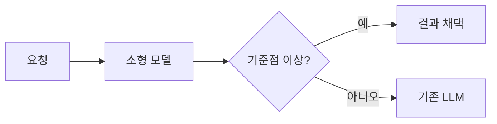

# 손가락 튕기기로 LLM 비용 줄이기

> [!abstract] 한 줄 정리
> SNAP은 검증 기준을 만족하는 요청만 소형 모델로 처리한다. 애매한 요청은 기존 LLM으로 넘겨 전면 교체의 부담을 줄인다.

## 핵심 내용

SNAP은 system prompt 앞부분의 해시로 작업을 묶고 비용순으로 후보를 고른다. 레이블 추출과 평가 데이터 분리가 가능한 작업만 학습하며 이를 일일 배치로 연결한다.

동일상품 판별에서 Confidence 기준점별 LLM 레이블 일치율과 채택 비율(Coverage)을 비교했다. 점수는 정답률이 아니다. 아래는 모델·기준점 선택용 오프라인 결과다.

| 오프라인 조건/관찰 | 값 |
| --- | --- |
| 검증 요청 / 채택 | 100,648 / 34,963건 |
| 목표 일치율 / 관찰 일치율 | 99.9% / 99.9028% |
| Coverage | 34.74% |

기준 미달이면 LLM을 추가 호출하는 분기를 자체 재구성했다.

배포 후 약 6일간 일별 처리 비율은 약 33~37%였다. 일치율과는 다른 지표다. 가상 비용표·분포를 실측으로 옮기지 않았다. Figure 5는 이용 조건 미확인으로 임베드를 생략했다.

## 왜 읽을까

품질과 처리 비율의 균형을 배울 수 있다. 작은 모델의 가격만으로 전환을 결정하지 않는다.

**적용 연습(제안·미검증):** 별도 정답셋으로 오류 비용과 fallback 비율을 평가한다. LLM과의 일치를 정답으로 간주하지 않는다.

---

**원문:** [손가락 튕기기로 LLM 비용 줄이기](https://toss.tech/article/54329)
