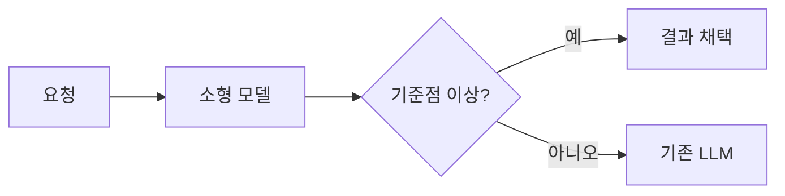

# 손가락 튕기기로 LLM 비용 줄이기

> [!abstract] 한 줄 정리
> SNAP은 검증 기준을 만족하는 요청만 소형 모델로 처리한다. 애매한 요청은 기존 LLM으로 넘겨 전면 교체의 부담을 줄인다.

## 핵심 내용

상용 LLM은 복잡한 작업을 빠르게 도입하기 좋지만, 단순 분류까지 모두 같은 모델로 처리하면 비용과 지연이 누적된다. 토스의 SNAP(Selective Native AI Processing)은 전체 요청을 작은 모델로 한 번에 전환하지 않고, 검증된 구간만 소형 모델이 처리하고 나머지는 기존 LLM으로 돌려보내는 방식이다. 내재화 비율 자체보다 업무가 요구하는 품질을 먼저 확보한다는 것이 설계 기준이다.

후보 발굴에서는 호출 로그의 system prompt 앞부분을 해시해 작업 단위의 fingerprint를 만든다. 같은 API 키나 엔드포인트만으로는 동일한 작업을 구분할 수 없기 때문이다. Airflow 일일 배치가 작업별 호출량·토큰·추정 비용을 집계해 고비용 후보를 선택하고, 응답에서 레이블을 안정적으로 추출하며 학습·평가 데이터를 분리할 수 있는 작업만 학습에 보낸다. 학습된 모델은 모델 레지스트리에 등록되고, 서빙 엔진이 운영 요청에 사용한다.

첫 대상은 브랜드·용량·색상·구성품 등을 비교해 두 상품이 같은 판매 단위인지 분류하는 작업이다. 모델은 판단 결과와 Confidence를 내지만, 점수가 0.95라는 이유만으로 정답률이 95%라고 볼 수 없다. 토스는 검증 데이터에서 임계값별 **기존 LLM의 판단과 일치한 비율(Selective Accuracy)** 및 **소형 모델의 결과를 채택한 비율(Coverage)**을 함께 비교해 모델과 임계값을 선택했다. 아래 수치는 모델 선정에 사용한 오프라인 검증 결과이며, 독립 정답셋 기준의 정확도는 아니다.

| 오프라인 조건/관찰 | 값 |
| --- | --- |
| 검증 요청 / 채택 | 100,648 / 34,963건 |
| 목표 일치율 / 관찰 일치율 | 99.9% / 99.9028% |
| Coverage | 34.74% |

기준 미달이면 LLM을 추가 호출하는 분기를 자체 재구성했다.

운영에서는 클라이언트가 GenAI Gateway를 통해 먼저 소형 모델을 호출하고, Confidence가 검증된 임계값보다 낮으면 기존 LLM을 추가 호출한다. 따라서 요청을 소형 모델로 처리하는 비율은 운영 트래픽 분포에 따라 달라질 수 있다. 배포 후 약 6일 동안 일별 처리 비율은 약 33~37%로, 오프라인 Coverage 34.74%와 비슷한 수준이었다. 이 기간 LLM 사용량은 입력 토큰 약 76억 개, 출력 토큰 약 4,520만 개 줄었다고 보고됐다. 이는 토큰 사용 감소량이지 확인된 금액 절감액은 아니다.

별도의 서빙 부하 테스트에서는 **L4 GPU 1장** 환경에서 실제 초당 1,203건을 처리할 때 클라이언트 측 p50은 9.02ms, p99는 15.23ms였으며 테스트 구간에서 요청 실패·드롭이 없었다. 이 측정은 소형 모델 서빙 구간에 관한 것이지, fallback을 포함한 전체 GenAI Gateway 경로의 응답 지연을 증명하지 않는다. 원문의 가상 비용표·Confidence 분포는 실측으로 취급하지 않았으며, Figure 5는 외부 표시 권리를 확정하지 못해 임베드하지 않았다.

## 왜 읽을까

이 사례는 **전체 전환 대신 선택적 처리와 fallback을 설계하는 판단 기준**을 보여준다. 비용이 큰 작업을 먼저 찾고, 학습 데이터의 적합성과 품질 임계값을 검증한 후 운영 트래픽 일부부터 전환하는 과정이 핵심이다. Coverage를 높이려다 오류 비용이 커질 수 있고, 소형 모델 서빙 자원과 fallback 비용도 남으므로 토큰 감소량만으로 경제성을 확정하면 안 된다.

**적용 연습(제안·미검증):** 별도 정답셋으로 오류 비용과 fallback 비율을 평가한다. LLM과의 일치를 정답으로 간주하지 않는다.

---

**원문:** [손가락 튕기기로 LLM 비용 줄이기](https://toss.tech/article/54329)
