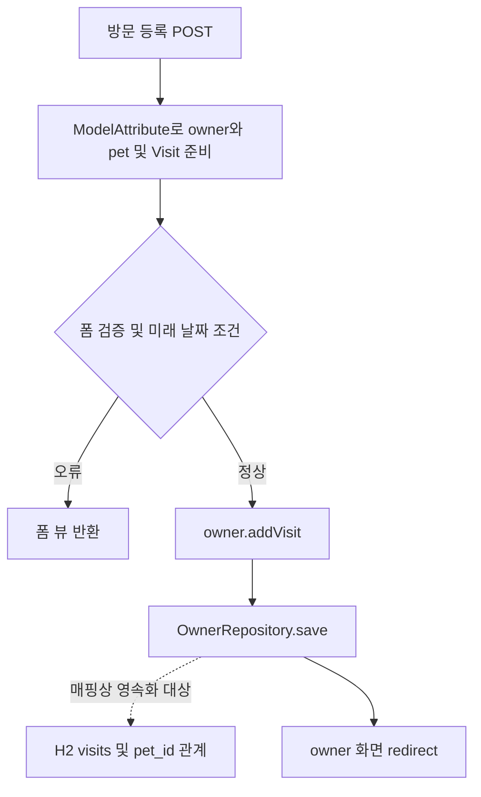

# reverse-engineering 검증

검증일: 2026-11-07. 구현 기준: `dev`의 `e29d43c`. 기존 스킬을 변경하지 않았다.

## 검증 방법과 대상

현재 Codex가 새 스킬의 지침을 직접 적용해 실제 공개 프로젝트의 구조·흐름·이력을 복원했다. 별도 모델/서브에이전트 평가나 클라이언트의 자동 스킬 선택 검증은 아니다. 분석 대상은 [Spring Petclinic의 고정 SHA](https://github.com/spring-projects/spring-petclinic/tree/500158f732419217507c7656904b8e6aa1bcc0d6) `500158f732419217507c7656904b8e6aa1bcc0d6`다. 학습용 샘플을 실제 운영 배포로 취급하지 않았다.

요청: “방문 등록은 어떤 경로로 DB에 연결되는가? 반려동물 종류 조회 저장소는 왜 나뉘었는가? 코드와 문서가 다를 때 무엇을 믿을 수 있는가?”

작업 디렉터리 밖의 새 임시 복제본에서 읽기 전용으로 조사했다. 코드·설정·문서를 수정하거나 checkout/pull하지 않았고 빌드·테스트·서버·DB를 실행하지 않았다. 복제본 준비와 필요한 Git 객체 다운로드 외에는 대상에 쓰지 않았다. 분석 전후 `git status --short`는 모두 빈 출력이었다.

```powershell
git clone --depth 100 --filter=blob:none --sparse https://github.com/spring-projects/spring-petclinic.git "$reverseRoot/petclinic"
git -C "$reverseRoot/petclinic" sparse-checkout set src/main/java/org/springframework/samples/petclinic/owner src/main/java/org/springframework/samples/petclinic/model src/main/resources/db/h2 src/test/java/org/springframework/samples/petclinic/owner
git -C "$reverseRoot/petclinic" rev-parse HEAD
git -C "$reverseRoot/petclinic" log -n 7 --format='%h %s' -- src/main/java/org/springframework/samples/petclinic/owner/VisitController.java src/main/java/org/springframework/samples/petclinic/owner/OwnerRepository.java
```

전체 저장소의 모든 파일이나 이력을 읽지 않았다. 방문 등록에서 시작해 repository·entity·관련 설정·H2 DDL·MVC 테스트로 확장했다. 저장소 분리 이유를 확인할 때만 관련 commit과 직접 변경된 PetController/PetTypeRepository를 추가 조사했다. clone은 shallow이며 조사한 과거가 전체 역사는 아니다.

## 사례 A — 현재 구조와 요청→DB 복원

핵심 결론: Boot 애플리케이션 안에서 owner 영역의 MVC controller가 도메인 객체와 JPA repository를 직접 사용한다. 이 경로에 별도 service 계층을 가정하지 않았다. package를 독립 서비스나 배포 경계로 해석하지 않았다.

| 책임/흐름 | 직접 확인한 근거와 설명 |
| --- | --- |
| 부트스트랩·의존성 | [PetClinicApplication](https://github.com/spring-projects/spring-petclinic/blob/500158f732419217507c7656904b8e6aa1bcc0d6/src/main/java/org/springframework/samples/petclinic/PetClinicApplication.java)의 Boot 진입점. [pom.xml](https://github.com/spring-projects/spring-petclinic/blob/500158f732419217507c7656904b8e6aa1bcc0d6/pom.xml#L5)은 Boot 4.1.0과 Java 17을 선언한다. 이는 의존성/빌드 선언이며 실제 실행 JDK·해석된 dependency tree·배포 버전은 미확인이다. |
| HTTP 진입 | [VisitController.java:97](https://github.com/spring-projects/spring-petclinic/blob/500158f732419217507c7656904b8e6aa1bcc0d6/src/main/java/org/springframework/samples/petclinic/owner/VisitController.java#L97)의 POST `/owners/{ownerId}/pets/{petId}/visits/new`. JSON REST 응답이 아니라 폼과 뷰를 처리한다. |
| 객체 준비 | 같은 파일의 `loadPetWithVisit`(:63)은 ownerId로 owner를 조회하고 `Owner.getPet`으로 그 owner의 pet을 찾는다. 없으면 예외를 던진다. 새 Visit를 pet의 메모리상 컬렉션과 모델에 연결한다. 예외의 최종 HTTP 변환은 추적 범위 밖이므로 임의로 404라고 쓰지 않았다. |
| 검증·실패 | `processNewVisitForm`은 바인딩된 Visit의 검증 결과와 미래 날짜 조건을 확인한다. 오류가 있으면 폼 뷰를 반환하며 그 분기에는 `owners.save` 호출이 없다(:100–105). 실제 SQL/HTTP 실행을 관찰했다는 뜻은 아니다. |
| 정상 저장·응답 | 같은 메서드는 `owner.addVisit(petId, visit)` 후 `owners.save(owner)`를 호출하고 owner 화면으로 redirect한다(:108–111). [Owner.addVisit](https://github.com/spring-projects/spring-petclinic/blob/500158f732419217507c7656904b8e6aa1bcc0d6/src/main/java/org/springframework/samples/petclinic/owner/Owner.java#L176)은 해당 pet의 방문 컬렉션으로 연결한다. 단순 파일 요약이 아니라 요청의 값과 객체 변경을 이어서 추적했다. |
| 영속화 연결 | [OwnerRepository](https://github.com/spring-projects/spring-petclinic/blob/500158f732419217507c7656904b8e6aa1bcc0d6/src/main/java/org/springframework/samples/petclinic/owner/OwnerRepository.java#L36)는 JpaRepository를 상속한다. [Owner:67](https://github.com/spring-projects/spring-petclinic/blob/500158f732419217507c7656904b8e6aa1bcc0d6/src/main/java/org/springframework/samples/petclinic/owner/Owner.java#L67)의 pets와 [Pet:56](https://github.com/spring-projects/spring-petclinic/blob/500158f732419217507c7656904b8e6aa1bcc0d6/src/main/java/org/springframework/samples/petclinic/owner/Pet.java#L56)의 visits에는 cascade 매핑과 owner_id/pet_id 연결이 선언되어 있다. Visit는 visits 테이블, 날짜는 visit_date로 매핑된다. |
| DB 설정·모델 | [application.properties](https://github.com/spring-projects/spring-petclinic/blob/500158f732419217507c7656904b8e6aa1bcc0d6/src/main/resources/application.properties#L2)는 database=h2, 그 값에 따른 SQL 초기화 경로, ddl-auto=none, open-in-view=false를 선언한다. [H2 schema.sql:58](https://github.com/spring-projects/spring-petclinic/blob/500158f732419217507c7656904b8e6aa1bcc0d6/src/main/resources/db/h2/schema.sql#L58)에서 visits의 pet_id/visit_date/description과 pets 참조를 대조했다. 환경 오버라이드·활성 프로필·운영 DB는 확인하지 않았다. |
| 테스트의 범위 | [VisitControllerTests:44](https://github.com/spring-projects/spring-petclinic/blob/500158f732419217507c7656904b8e6aa1bcc0d6/src/test/java/org/springframework/samples/petclinic/owner/VisitControllerTests.java#L44)는 WebMvcTest와 mock repository를 사용한다. 정상 redirect·날짜/설명 오류 검증의 존재를 확인했다. DB cascade·commit·SQL 순서와 테스트 통과를 증명하지 않는다. |

이 요청 경로에서 복원한 정적 연결을 분기로 표현했다. 다이어그램은 실행 trace가 아니며 ORM 이후의 실제 SQL/커밋 시점은 미확인이다.



owner와 pet의 관계 확인은 로그인 사용자 권한 확인과 동일하지 않다. 보안 구성·gateway를 확인하지 않았으므로 운영 인가 유무를 단정하지 않았다. JPA를 선택한 최초 이유도 pom이나 현재 코드만으로는 복원할 수 없어 **미확인**으로 남겼다. 새로운 개선안은 원래 의도로 제시하지 않았다.

## 사례 B — 구조 변경과 기록된 이유

다음 커밋을 본문과 부모 대비 diff로 확인했다. 인용한 의도는 작성 당시의 설명이며 현재 프레임워크 결함의 독립 재현 결과가 아니다.

```powershell
git -C "$reverseRoot/petclinic" show -s --format='%H%n%B' 142321a
git -C "$reverseRoot/petclinic" show --format= 142321a -- src/main/java/org/springframework/samples/petclinic/owner/OwnerRepository.java src/main/java/org/springframework/samples/petclinic/owner/PetTypeRepository.java src/main/java/org/springframework/samples/petclinic/owner/PetController.java
git -C "$reverseRoot/petclinic" show --format= 753d35c -- src/main/java/org/springframework/samples/petclinic/owner/Visit.java src/main/java/org/springframework/samples/petclinic/owner/VisitController.java src/test/java/org/springframework/samples/petclinic/owner/VisitControllerTests.java
```

| 근거 | 복원 결과와 확신 범위 |
| --- | --- |
| [142321aa3ed056eeda0662c1987b76db25b3d736](https://github.com/spring-projects/spring-petclinic/commit/142321aa3ed056eeda0662c1987b76db25b3d736), 부모 `b21890c126176dad14e7985575dbb78e2c6fcf6d` | **과거 사실:** OwnerRepository의 findPetTypes/JPQL이 새 PetTypeRepository로 이동하고 PetController가 새 repository를 주입받아 종류를 조회하도록 바뀌었다. **기록된 이유:** 본문은 테스트 실패와 엔티티 유형별 repository 책임 유지를 설명한다. Spring Data가 PetType을 DTO로 취급해 constructor query를 만든 것 같다는 설명은 작성자의 추정이다. 실제 실패 로그·정확한 버전별 원인을 검증한 사실로 승격하지 않았다. |
| 현재 PetController:55–64와 PetTypeRepository:30–37 | **현재 사실:** 종류 조회가 분리된 repository를 사용하는 구조가 고정 SHA에도 남아 있다. 독립 DB·마이크로서비스·성능 향상을 위해 분리했다고 추가 추정하지 않았다. |
| [753d35c2f84432d88c0f3b61c9302a16069b78dd](https://github.com/spring-projects/spring-petclinic/commit/753d35c2f84432d88c0f3b61c9302a16069b78dd), 부모 `3c06fbfc1e42eb40802e0d0ca989bc9226755804` | **과거 사실:** Visit 기본 날짜가 오늘에서 내일로 바뀌고, 컨트롤러의 미래 날짜 검사·최소 날짜 모델·관련 테스트가 추가됐다. 제목과 diff는 미래 날짜 검증 추가를 뒷받침한다. 왜 과거 진료 이력을 금지해야 했는지, 실제 장애·사용자 요구가 있었는지는 확인하지 못했다. 테스트 추가를 실행 통과로 보고하지 않았다. |
| [c7ee170434ec3e369fdc9201290ba2ea4c92b557](https://github.com/spring-projects/spring-petclinic/commit/c7ee170434ec3e369fdc9201290ba2ea4c92b557) | **과거 사실:** VisitController binder의 제외 필드에 중첩 id 패턴이 추가됐다. 구체적 사고·CVE가 원인이었다고 추정하지 않았다. |

이력은 실제로 확보된 관련 commit과 부모에 한정한다. PR/Issue의 별도 본문·승인·배포 상태는 조사하지 않았으며, 커밋을 근거로 승인·병합 시점·운영 배포를 만들어 내지 않았다.

## 사례 C — 코드·문서 불일치와 추측 방지

| 입력/상황 | 실제 판정 |
| --- | --- |
| 실제 VisitController:61의 Javadoc 반환 설명은 Pet이지만 :64의 반환형과 :80의 반환 객체는 Visit다. | 작은 문서 불일치로 명시했다. 객체 준비 흐름은 실제 반환형/본문을 따르며 문서나 코드를 수정하지 않았다. 이것만으로 설계 전반의 품질 문제를 선언하지 않았다. |
| 별도 검증 입력: “방문 등록은 오류 여부와 관계없이 먼저 DB 저장 후 결과를 돌려준다”라는 설계 메모. 원본 저장소의 문서라는 주장은 하지 않았다. | :104–109의 오류 분기와 save 위치로 반박하고 코드상 성공/실패 경로를 복원했다. ORM 실행 로그나 모든 오류 상황의 DB 무변경까지 입증했다고 하지 않았다. 메모 작성 의도는 알 수 없다고 표시했다. 이 입력은 메모리에 제공했으며 대상 프로젝트 파일에 추가하지 않았다. |
| readme의 소개 슬라이드에는 이전 Spring Boot 이전 구현일 수 있다는 경고가 있다. | 오래된 자료를 현재 service 경로의 증거로 사용하지 않았다. 과거 설명을 무조건 잘못된 현재 문서로 판정하지 않고 버전 적용 범위를 구분했다. |
| “왜 JPA인가? repository 분리는 MSA 전환 준비였나?” | 최초 JPA 선택 이유와 MSA 의도는 미확인. repository 분리에 관해 읽은 commit 본문의 이유만 설명했다. 현재 구조의 장점을 원래 개발자의 의도로 바꾸지 않았다. |

## 공식 형식과 보존 확인

[Agent Skills 명세](https://agentskills.io/specification)의 reference 구현 `skills-ref 0.1.0`(원본 SHA `83021e2be457a9b6679148719c1f6074f0ad975e`)과 번들 검증기를 사용했다. `$validationRoot`는 저장소 밖에 이미 준비된 임시 Python 가상환경이다.

```powershell
& "$validationRoot/venv/Scripts/python.exe" -X utf8 -m skills_ref.cli validate ./reverse-engineering
& "$validationRoot/venv/Scripts/python.exe" -X utf8 C:/Users/guseo/.codex/skills/.system/skill-creator/scripts/quick_validate.py ./reverse-engineering
```

결과: **`Valid skill: reverse-engineering`**, **`Skill is valid!`**, 모두 exit 0. 이름/폴더·필수 frontmatter·description 검증 통과. 스킬은 SKILL.md 하나이며 로컬 참조·실행 스크립트·다른 스킬 의존성이 없다.

## 판정과 한계

- **확인:** 실제 Java/Spring 코드의 모듈 책임과 대표 POST→도메인→repository→ORM/DDL 연결, 정상/오류 분기, 실제 Git diff에 따른 repository 분리와 날짜 규칙 변경, 기록된 이유와 추정의 분리, 문서 불일치 표시, 고정 SHA·경로·심볼/행을 통한 추적 가능성.
- **미검증:** 실제 요청/SQL/트랜잭션 실행, 활성 운영 프로필·배포·권한, 원래 테스트 실패 원인의 재현, 별도 PR/Issue 자료, Java/Spring 이외 언어, Mermaid 렌더링, 자동 스킬 선택·클라이언트 통합·독립 모델 평가. 다이어그램은 정적 설명 소스이며 렌더링 통과로 표기하지 않는다.
- 분석 대상 파일의 변경·자동 문서 저장·리팩터링·외부 게시를 수행하지 않았다. 이 검증 보고서는 사용자가 요청한 스킬 구현 산출물이며 분석 대상 프로젝트에 저장한 문서가 아니다. 구현 저장소에는 새 스킬과 이 보고서만 추가한다.
